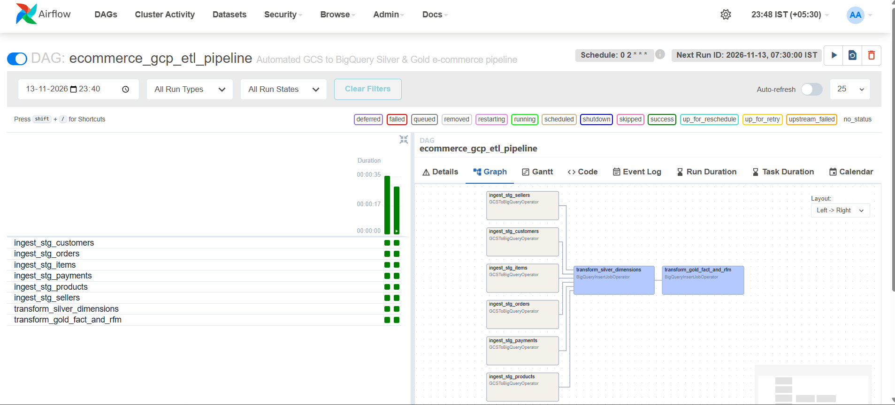
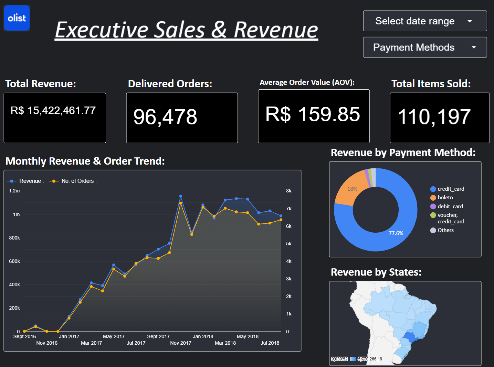
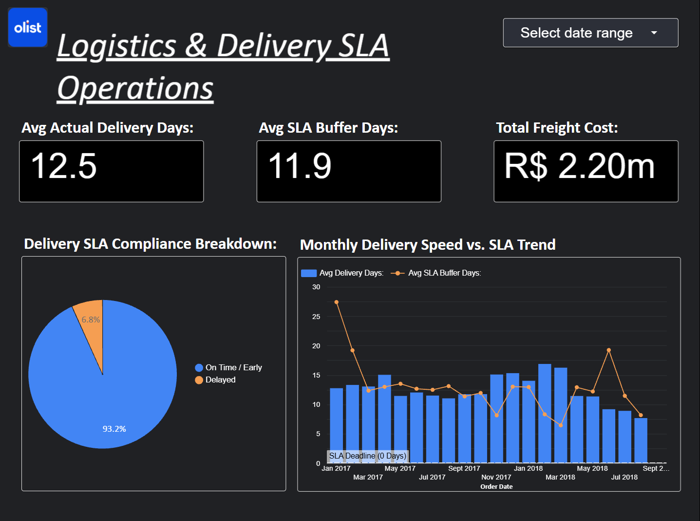
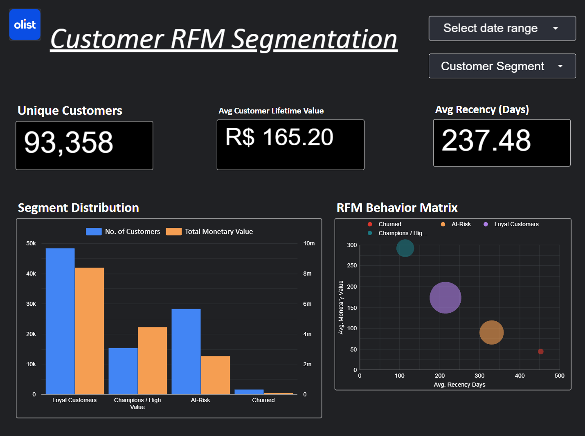

# End-to-End E-Commerce Data Pipeline & Executive BI (v1)

An automated batch data engineering and analytics pipeline built on **Google Cloud Platform (BigQuery & GCS)**, **Apache Airflow**, **Docker**, and **Looker Studio** using the Brazilian Olist E-Commerce dataset (~100k orders).

---

## Architecture Overview

```text
[Olist Raw CSVs] ──► [Google Cloud Storage (GCS)]
                            │
                            ▼  (Apache Airflow on Docker - Daily @ 02:00 UTC)
             [BigQuery Staging Layer (staging.*)]
                            │
                            ▼  (Deduplication & Standardization)
          [BigQuery Silver Layer (analytics_silver.*)]
           ├── dim_customers
           ├── dim_products
           └── dim_sellers
                            │
                            ▼  (Star-Schema Fact, RFM Cohorts & ISO Geo View)
           [BigQuery Gold Layer (analytics_gold.*)]
           ├── fact_orders (Delivered-Order Grain)
           ├── agg_customer_rfm (SQL NTILE Segmentation)
           └── vw_orders_regional (ISO 3166-2 Brazil State View)
                            │
                            ▼
        [3-Page Looker Studio Executive Dashboard]
```

---

## Key Engineering Highlights

* **Keyless GCP Authentication in Docker:** Configured **Application Default Credentials (ADC)** mounted read-only into Airflow containers (`./config:/opt/airflow/config:ro`) to comply with GCP organization policies (`iam.disableServiceAccountKeyCreation`) without static service account JSON keys.
* **Self-Healing Airflow Webserver:** Added startup PID cleanup (`rm -f /opt/airflow/airflow-webserver.pid`) in `docker-compose.yaml` to prevent stale Gunicorn lock crashes across host sleep and restart cycles.
* **Medallion Warehouse Modeling:** Separated raw batch ingestion (`WRITE_TRUNCATE`), standardized Silver dimensions, delivered-order Gold facts (`fact_orders`), SQL `NTILE(4)` RFM cohorts (`agg_customer_rfm`), and a denormalized ISO-prefixed view (`BR-SP`, `BR-RJ`) for accurate Looker Studio regional mapping.

---

## Dashboard Insights (`Olist E-Commerce Executive Analytics`)

1. **Executive Sales & Revenue:** **R$ 15.42M** (`R$ 15,422,461.77`) in delivered revenue across **96,478 orders** (**R$ 159.85 AOV**, **110,197 items sold**), with credit cards driving **77.6%** of total payment volume.
2. **Logistics & Delivery SLA Operations:** **93.2%** on-time/early delivery rate (**12.5** average transit days vs. an **11.9-day** average SLA buffer) and **R$ 2.20M** total freight cost, pinpointing a March 2018 carrier transit bottleneck.
3. **Customer RFM Segmentation:** **93,358** unique customers (**R$ 165.20** average lifetime value, **237.48** avg recency days) segmented across *Champions / High Value*, *Loyal Customers*, *At-Risk*, and *Churned* cohorts.

---

## Pipeline & Dashboard Preview

### Apache Airflow Medallion DAG (`ecommerce_gcp_etl_pipeline`)


### Page 1: Executive Sales & Revenue


### Page 2: Logistics & Delivery SLA Operations


### Page 3: Customer RFM Segmentation


---

## Repository Structure

```text
├── assets/                          # Airflow DAG and Looker Studio screenshots
├── config/
│   └── .gitkeep                     # Mount point for local ADC credentials (ignored by Git)
├── dags/
│   └── ecommerce_gcp_pipeline.py    # Main Airflow Medallion ETL DAG
├── sql/
│   └── vw_orders_regional.sql       # BigQuery Gold view for Brazil ISO state geo-mapping
├── .gitignore                       # Blocks credentials, logs, and local runtime artifacts
├── docker-compose.yaml              # Multi-container Apache Airflow setup
└── README.md
```

---

## Local Setup & Execution

1. **Clone the repository:**
   ```bash
   git clone https://github.com/swarupchakraborty467E/ecommerce-gcp-airflow-pipeline.git
   cd ecommerce-gcp-airflow-pipeline
   ```
2. **Configure keyless GCP credentials:**
   ```bash
   gcloud auth application-default login
   ```
   Copy your generated `application_default_credentials.json` into `./config/` and set `PROJECT_ID` and `GCS_BUCKET` (`<ecommerce-analytics-lake-nov26>`) in `dags/ecommerce_gcp_pipeline.py`.
3. **Launch Airflow with Docker Compose:**
   ```bash
   docker compose up -d
   ```
   Open `http://localhost:8080` in your browser and trigger `ecommerce_gcp_etl_pipeline`.

---
